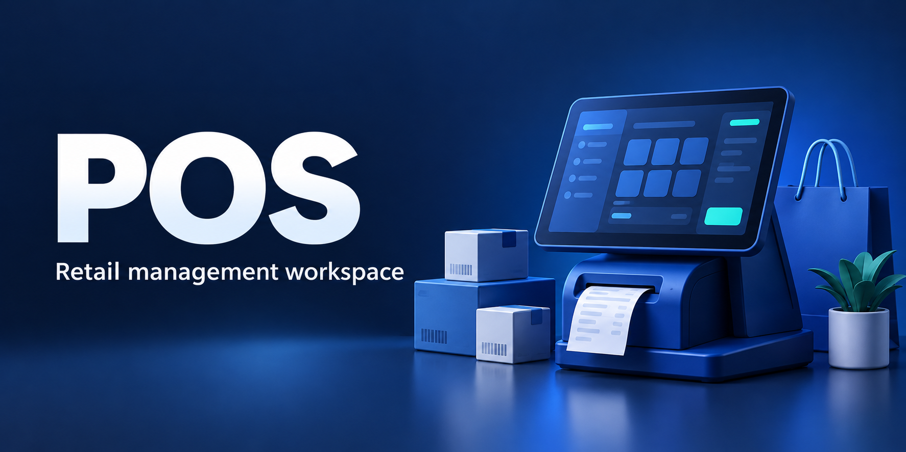
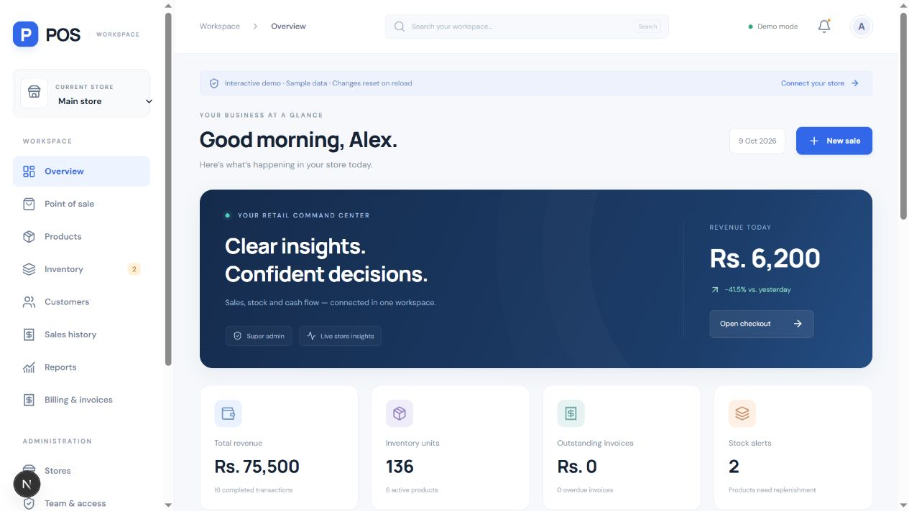
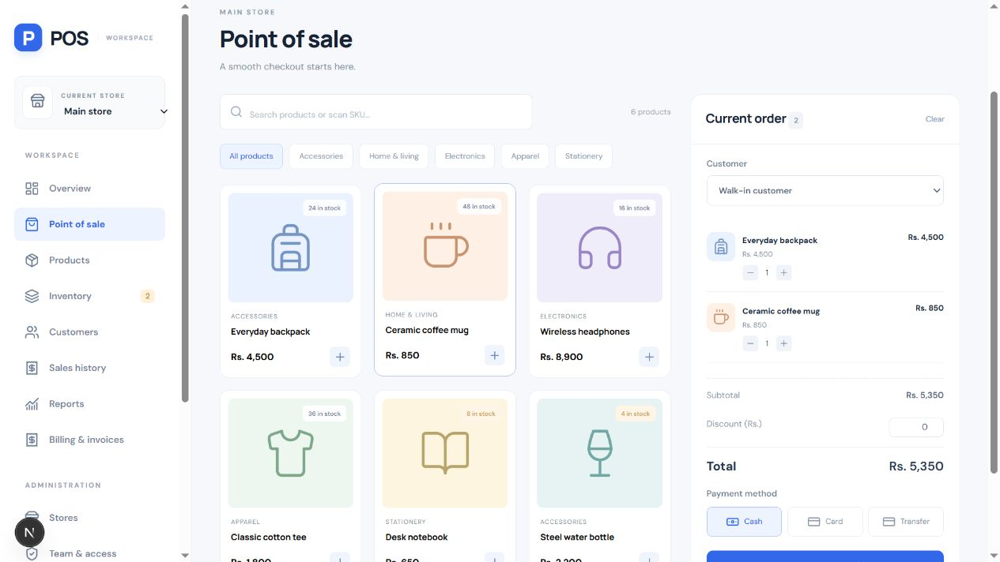
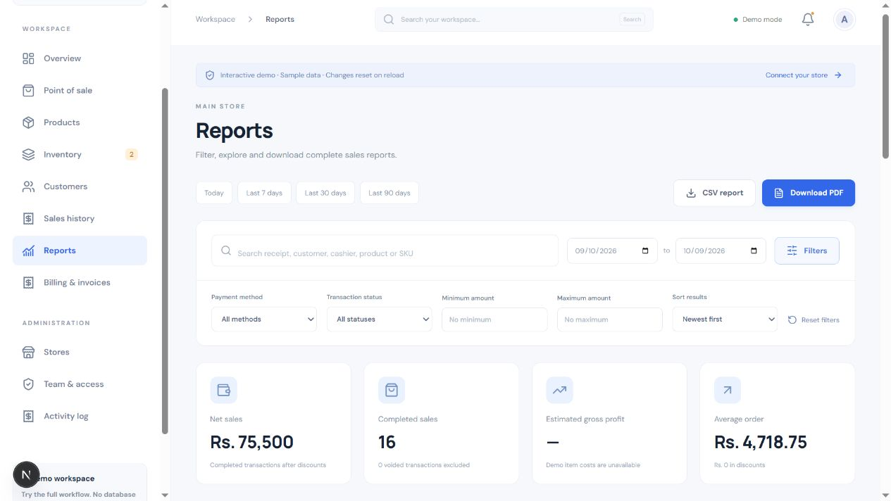
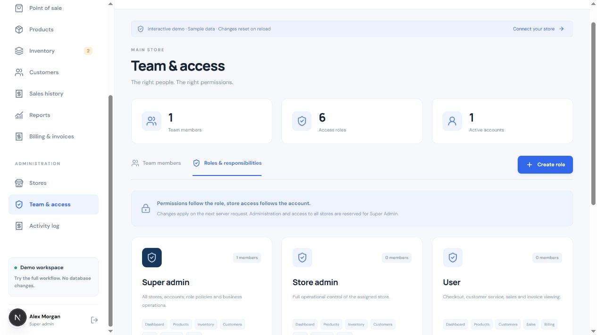
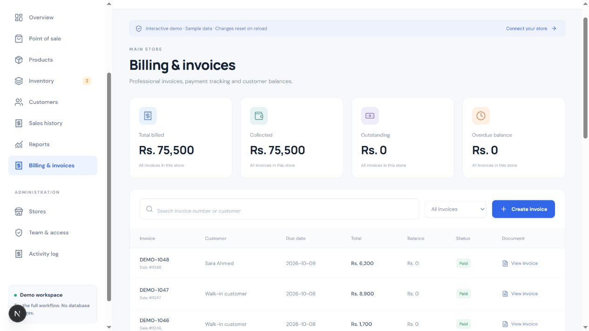
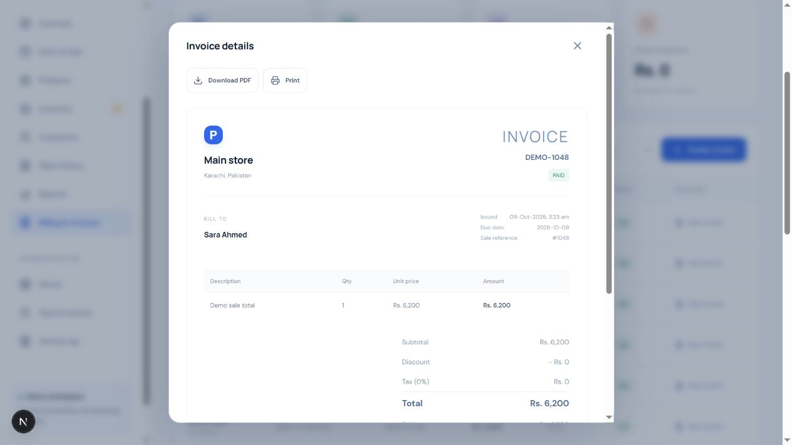
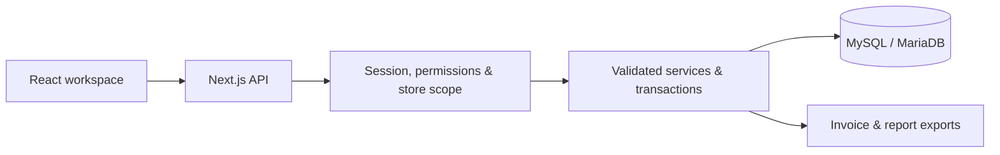

# POS · Retail management workspace

A responsive web-based point of sale application connecting **checkout, inventory, billing, reporting and team access**. Built with **Next.js, TypeScript and MySQL**, with local database setup through **XAMPP**.


[Quick start](#quick-start) · [Screenshots](#screenshots) · [Features](#features) · [Architecture](#architecture) · [Full user guide](docs/USER_GUIDE.md)

## Screenshots

Real application screenshots with synthetic interactive-demo data. The cover is an AI-generated promotional illustration.

| Dashboard | Checkout |
| --- | --- |
|  |  |

| Reports | Team and access |
| --- | --- |
|  |  |



<details>
<summary>View a generated demo invoice</summary>



</details>

## Features

| Module | Capabilities |
| --- | --- |
| Dashboard | Revenue, stock alerts, outstanding balances and 7/30-day trends |
| Checkout | Product/SKU search, cart, customer selection, discounts, tender methods and receipts |
| Catalog & inventory | Products, categories, selling/cost prices, stock adjustments, reorder levels and movement history |
| Customers & sales | Customer records, searchable transaction history and sale voiding with stock restoration |
| Reports | Date, payment, status, amount and text filters; pagination; matching CSV/PDF exports |
| Billing | Checkout/standalone invoices, partial payments, balances, printing and PDF downloads |
| Team & access | User management, store assignments, custom roles and granular permissions |
| Administration | Multi-store management, server-enforced store scope and audit activity |

**Included roles:** Super Admin, Admin, User, Cashier, Inventory Manager and Accountant. Super Admin controls role responsibilities; global administration remains protected.

## Quick start

**Requirements:** Node.js 24 recommended, npm and XAMPP MySQL/MariaDB. Next.js runs on Node.js; XAMPP supplies the database.

Start **MySQL** in XAMPP, then use the VS Code PowerShell terminal:

```powershell
git clone https://github.com/Umersaleem98/POS.git
cd POS
npm ci
Copy-Item .env.example .env
notepad .env
```

Configure the database connection, your own `SEED_EMAIL` / `SEED_PASSWORD`, and a random `SESSION_SECRET` of at least 32 characters:

```powershell
node -e "console.log(require('crypto').randomBytes(48).toString('hex'))"
npm run db:setup
npm run dev
```

Open [localhost:3000](http://localhost:3000) and sign in with the seed credentials you configured. No live-account password is published.

**Demo:** choose **Open interactive demo** to explore without MySQL. Demo changes reset on reload or sign-out.

**Existing installation:** preserve your `.env`, then run `npm ci` and `npm run db:migrate`. See the [user guide](docs/USER_GUIDE.md) for upgrade details.

## Architecture

The React frontend and authenticated API share one Next.js application. MySQL/MariaDB stores accounts, permissions, stores, products, stock movements, sales, invoices, payments and audit events.



```text
POS/
├── database/              Relational schema
├── scripts/               Setup and additive database migration
├── src/
│   ├── app/api/           Authentication and protected routes
│   ├── components/        Checkout, catalog and workspace UI
│   │   └── advanced/      Dashboard, reports, billing and team
│   └── lib/               Database, permissions and services
├── tests/                 Unit and live integration tests
├── docs/                  User guide, cover and screenshots
└── .github/               CI, issue and pull request templates
```

## Access and data integrity

- Signed HttpOnly/SameSite cookie sessions and bcrypt password hashes.
- Server-side permissions, store isolation, input validation and parameterized SQL.
- Same-origin checks for mutations.
- Checkout uses server prices and row locks; sale, stock, invoice and audit updates commit together.
- Retry identifiers prevent duplicate checkouts/payments; payment row locks prevent overpayment.
- CSV exports guard against spreadsheet formula injection.

## Verification

```powershell
npm run typecheck
npm test
npm run build
```

GitHub Actions runs these checks on pushes to `main` and pull requests. Live integration tests are opt-in and require the application and MySQL running:

```powershell
$env:POS_INTEGRATION = "1"
npm run test:integration
Remove-Item Env:POS_INTEGRATION
```

Coverage includes permissions, store isolation, concurrent checkout/payments, retry safety, stock restoration and report/PDF/CSV exports. Read the [test instructions](docs/USER_GUIDE.md#live-integration-tests) first.

## Scope

Currency defaults to Pakistani rupees; business dates use Asia/Karachi. Tender methods record payment types without charging cards or making transfers. Standalone invoices do not move stock. Gross profit excludes operating expenses. Report exports support up to 10,000 matching transactions.

Suppliers, purchase orders, partial returns, cashier shifts, hardware/payment gateway integration and offline sync are future modules. Downloaded PDFs use Latin fonts; browser printing supports Unicode.

For public deployment, configure HTTPS, a dedicated database account, backups, monitoring, account recovery and business tax/payment requirements. See the [full user guide](docs/USER_GUIDE.md) for operational details.

## Contributing and images

See [CONTRIBUTING.md](CONTRIBUTING.md) and [image provenance](docs/IMAGES.md). No software license has been selected; publication alone does not grant reuse rights.

